# AlgoLab hub · Ministères sociaux

> **English summary.** AlgoLab hub is a private web portal built for one student group of Sciences Po's *AlgoLab* course (investigation of the VisuDSN algorithm used by the French labour inspectorate). It organises teamwork: a categorised document library synchronised with Google Drive (two-way for Google Docs created by the app), a calendar with sessions and deadlines, deadline breakdowns into tasks, a people directory, an investigation-journal section, a discussion wall with replies, and a global search bar. Stack: Next.js 16 (App Router, React 19, TypeScript), Supabase (Auth, Postgres with Row Level Security, pg_cron), Google Drive API, deployed on Vercel. It works on desktop, iOS and Android (including foldables). Access is restricted to `@sciencespo.fr` Google accounts. **No secret and no real data are stored in this repository.**

> **Démo en ligne :** <https://algolab-hub.vercel.app> — la connexion est réservée aux comptes Google `@sciencespo.fr` (les évaluateurs sans compte peuvent consulter la [page de confidentialité](https://algolab-hub.vercel.app/confidentialite), le code et ce README).

---

## Sommaire

1. [Présentation](#1-présentation)
2. [Fonctionnalités](#2-fonctionnalités)
3. [Architecture](#3-architecture)
4. [Stack technique et choix](#4-stack-technique-et-choix)
5. [Sécurité et confidentialité](#5-sécurité-et-confidentialité)
6. [Modèle de données](#6-modèle-de-données)
7. [La synchronisation avec Google Drive](#7-la-synchronisation-avec-google-drive)
8. [Installation pas à pas](#8-installation-pas-à-pas)
9. [Variables d'environnement](#9-variables-denvironnement)
10. [Guide d'utilisation](#10-guide-dutilisation)
11. [Téléphones (iOS, Android, pliables)](#11-téléphones-ios-android-pliables)
12. [Structure du projet](#12-structure-du-projet)
13. [Développement](#13-développement)
14. [Dépannage](#14-dépannage)
15. [Limites connues et pistes d'amélioration](#15-limites-connues-et-pistes-damélioration)
16. [Contexte et crédits](#16-contexte-et-crédits)

---

## 1. Présentation

### Le contexte

L'**AlgoLab** est un enseignement de Sciences Po (École d'affaires publiques) où des groupes d'étudiants mènent une **enquête sur un algorithme utilisé dans l'action publique**. Le groupe « Ministères sociaux » enquête sur **VisuDSN**, un outil d'aide au ciblage des contrôles de l'Inspection du travail.

Une enquête de ce type produit beaucoup de matériaux : lectures, comptes rendus d'entretiens, documents des partenaires, journal d'enquête, échéances, notes de séance. Ils étaient dispersés entre un Drive partagé, des messageries et des fichiers locaux.

### Le problème résolu

> Comment un groupe de six étudiants retrouve-t-il tout, sait-il qui fait quoi pour quand, et discute-t-il de l'enquête, **sans quitter le Drive** où se fait l'écriture ?

### La réponse

AlgoLab hub est un **portail de pilotage** posé au-dessus du Drive :

- le **gros du travail rédigé reste dans Google Docs**, outil fait pour écrire à plusieurs ;
- le portail sert à **s'organiser** (calendrier, deadlines, tâches, personnes), à **tout retrouver** (documents classés par catégories, recherche globale) et à **échanger** (le mur) ;
- chaque document a un bouton « Ouvrir dans Drive » à côté de lui.

Le portail est **privé** : seuls les comptes Google en `@sciencespo.fr` peuvent s'y connecter.

---

## 2. Fonctionnalités

Le menu latéral (ou la barre d'onglets en bas sur téléphone) donne accès à six espaces, plus une barre de recherche toujours visible en haut.

### Tableau de bord
- trois bandeaux : **prochaine session**, **dernière session**, **prochaine deadline** (avec détails et compte à rebours) ;
- les tâches en cours, que l'on coche directement ;
- les documents modifiés récemment ;
- l'**activité du Drive** (fichiers ajoutés ou modifiés, par qui, quand) et le bouton **Synchroniser** ;
- un aperçu du mur.

### Documents
- documents **classés par catégories** (lectures, matériel brut, cours, informations, notes et comptes rendus, devoirs, outils…), avec compteurs ;
- les fichiers du Drive surveillé apparaissent **automatiquement**, rangés d'après leur dossier d'origine, en sous-sections **repliables** (bouton « Tout replier / Tout déplier ») ;
- **changer de catégorie** n'importe quel fichier du Drive d'un clic (le choix est mémorisé), ou revenir au classement automatique ;
- **Nouveau document** : l'app demande *où* le créer — **Google Doc dans le Drive**, **note dans l'app** seulement, ou **lien** vers une ressource existante ;
- **Ajouter un fichier depuis l'ordinateur** : choix du fichier, de la catégorie, puis du **dossier du Drive** où il est publié ;
- **télécharger** un document dans le **format choisi** : PDF, Word, OpenDocument, Markdown, texte ou HTML (Google Docs) ; Markdown, texte ou HTML (notes de l'app) ;
- « Ouvrir dans Drive » à côté de chaque document.

### Calendrier
- vue mensuelle avec **séances, rendez-vous et deadlines**, **horaires** compris ;
- une séance terminée n'est plus « prochaine » : elle passe en « dernière session » (comparaison à la minute, fuseau Europe/Paris) ;
- **créer, modifier, supprimer** un événement, visible par tout le groupe.

### Deadlines
- chaque rendu avec son **breakdown** : liste d'étapes (tâches) avec responsable, échéance et **barre de progression** ;
- tâches sans deadline, deadlines passées repliées.

### Journal d'enquête
- liste les **journaux Google Docs** du Drive (dernière modification, auteur), le **modèle d'entrée**, et l'activité récente. L'écriture se fait dans le Google Doc, ouvert en un clic.

### Mur
- espace de discussion : **publier** une impression, une idée, une question ou une décision (étiquettes), **répondre** aux autres, filtrer par étiquette ;
- chacun ne supprime que **ses propres** messages.

### Personnes
- le groupe, l'équipe pédagogique et les partenaires, par catégories, avec **e-mail**, **LinkedIn** et un bouton **Contacter** qui ouvre l'application mail.

### Recherche globale
- une barre en haut de chaque page : documents (titre, catégorie, contenu), **fichiers du Drive**, personnes, dates, tâches et mur.

---

## 3. Architecture

```mermaid
flowchart LR
    subgraph Client["Navigateur (ordinateur, iOS, Android)"]
        UI["Pages React<br/>(rendues côté serveur)"]
    end

    subgraph Vercel["Vercel · Next.js 16"]
        Pages["Pages (App Router)<br/>Server Components"]
        Actions["Server Actions<br/>(écritures)"]
        Routes["Route Handlers<br/>/api/upload · /api/documents/[id]/export<br/>/api/cron/drive-sync"]
        Proxy["proxy.ts<br/>session + redirection vers /login"]
    end

    subgraph Supabase
        Auth["Auth<br/>(Google OAuth)"]
        DB[("Postgres<br/>+ Row Level Security")]
        Cron["pg_cron + pg_net<br/>toutes les 15 min"]
    end

    subgraph Google
        OAuth["Google OAuth"]
        Drive["Drive API v3"]
    end

    UI --> Proxy --> Pages
    UI --> Actions
    UI --> Routes
    Pages --> DB
    Actions --> DB
    Pages -. connexion .-> Auth --> OAuth
    Routes --> Drive
    Routes --> DB
    Cron -- "GET + secret" --> Routes
```



### Le parcours d'une requête

1. Toute requête passe d'abord par [`src/proxy.ts`](src/proxy.ts) : il rafraîchit la session Supabase (cookie) et renvoie vers `/login` si personne n'est connecté.
2. Les **pages** sont des Server Components : elles lisent la base avec le **jeton de l'utilisateur**, donc la Row Level Security s'applique.
3. Les **écritures** passent par des Server Actions ([`src/app/actions.ts`](src/app/actions.ts)), qui vérifient à chaque appel que l'utilisateur est membre (`requireMember`).
4. La **synchronisation Drive** et les exports utilisent un client *serveur* : la clé `service_role` de Supabase n'est utilisée que dans la synchro, jamais envoyée au navigateur.
5. Toutes les 15 minutes, **pg_cron** (dans Supabase) appelle `/api/cron/drive-sync` avec un secret partagé.

---

## 4. Stack technique et choix

| Couche | Choix | Pourquoi |
|---|---|---|
| Framework | **Next.js 16** (App Router), **React 19**, **TypeScript** | Rendu côté serveur, Server Actions : pas d'API REST à écrire, peu de JavaScript côté client |
| Base et authentification | **Supabase** (Postgres, Auth Google, RLS, pg_cron) | Offre gratuite, sécurité au niveau des lignes, tâche planifiée intégrée |
| Hébergement | **Vercel** | Déploiement à chaque `git push`, HTTPS, offre gratuite |
| Drive | **Google Drive API v3** (appels `fetch` directs) | Aucune dépendance lourde : l'API est simple et les besoins sont limités |
| Style | **CSS maison** (`globals.css`), variables CSS | Aucune bibliothèque d'interface, thème crème et rouge clair défini en un seul endroit |
| Polices | Source Serif 4, IBM Plex Sans / Mono | Lisibilité, ton éditorial |

**Dépendances d'exécution : seulement cinq** — `next`, `react`, `react-dom`, `@supabase/ssr` et `@supabase/supabase-js`. Tout le reste (markdown, calendrier, export, recherche) est écrit dans le projet.

**Choix notables**
- *Server Components partout où c'est possible* : un seul composant client pour l'envoi de fichier, un autre pour replier les sous-sections, un pour la navigation active.
- *Pas de cache applicatif* (`cacheComponents: false`) : les données dépendent de l'utilisateur et doivent être fraîches.
- *Fuseau horaire explicite* (`Europe/Paris`) pour comparer les horaires des séances, indépendamment du serveur.

---

## 5. Sécurité et confidentialité

### Qui peut entrer ?
- La connexion se fait avec **Google**, restreinte au domaine `@sciencespo.fr` (paramètre `hd` côté Google, **et** vérification de l'adresse au retour de la connexion).
- Un compte hors domaine qui parviendrait à créer un compte Supabase est **déconnecté immédiatement**, et la RLS lui interdit toute donnée.

### Row Level Security
Toutes les tables ont la RLS activée ([`supabase/01-schema.sql`](supabase/01-schema.sql)). La fonction `public.is_member()` vérifie l'e-mail du jeton. Les règles fines :
- le **mur** : tout membre lit et publie ; **seul l'auteur** supprime son message ;
- `drive_files` et `drive_events` : **lecture seule** pour les membres, écrits uniquement par la synchro (côté serveur) ;
- tout le reste : lecture et écriture pour les membres.

### Secrets
- **Aucun secret n'est dans ce dépôt.** `.env*` (sauf `.env.example`, qui ne contient que des noms de variables vides) est ignoré par git, ainsi que le dossier local `private/`.
- La clé `service_role` de Supabase **contourne la RLS** : elle n'existe que dans les variables d'environnement de Vercel (et le `.env.local` local), jamais dans le navigateur.
- La route de synchro `/api/cron/drive-sync` exige l'en-tête `Authorization: Bearer <CRON_SECRET>`.

### Droits accordés à Google Drive (principe du moindre privilège)
| Scope | Ce que ça permet | Ce que ça n'autorise **pas** |
|---|---|---|
| `drive.metadata.readonly` | Lister les noms, dates et auteurs des fichiers des dossiers surveillés | Lire le **contenu** des fichiers |
| `drive.file` | Créer des fichiers et lire/modifier **ceux que l'app a elle-même créés** | Toucher aux autres documents du Drive (journal d'enquête, comptes rendus, documents des partenaires…) |

L'app **ne modifie, ne déplace et ne supprime jamais** un document qu'elle n'a pas créé.

### Données personnelles
Les données saisies sont celles du groupe (tâches, notes, personnes). Elles sont hébergées chez Supabase et Vercel, visibles des seuls membres connectés. Une page publique de [confidentialité](src/app/confidentialite/page.tsx) l'explique aux utilisateurs.

### Ce qui n'est volontairement pas sur GitHub
Le dépôt ne contient **ni données réelles** (noms, e-mails, identifiants de dossiers Drive, contenu de documents), **ni clés**. Le fichier [`supabase/02-exemple.sql`](supabase/02-exemple.sql) ne contient que des données **fictives**.

---

## 6. Modèle de données

Défini dans [`supabase/01-schema.sql`](supabase/01-schema.sql).

| Table | Rôle | Colonnes notables |
|---|---|---|
| `documents` | Bibliothèque de documents | `kind` (`gdoc` Google Doc lié au Drive · `note` texte de l'app · `link` lien), `category`, `drive_file_id`, `body`, `drive_error` |
| `file_categories` | Catégorie choisie à la main pour un fichier du Drive | `file_id`, `category` |
| `deadlines` | Rendus | `title`, `due`, `details` |
| `tasks` | Tâches (le *breakdown* d'une deadline) | `deadline_id` (facultatif), `owner`, `due`, `done` |
| `sessions` | Calendrier | `day`, `start_time`, `end_time`, `kind` (`seance`, `rdv`, `autre`) |
| `notes` | Le mur | `parent_id` (non nul = réponse), `tag` (`impression`, `idee`, `question`, `decision`) |
| `people` | Personnes | `category`, `role`, `email`, `linkedin` |
| `drive_folders` | Dossiers racines surveillés | `last_synced_at` |
| `drive_files` | État connu des fichiers du Drive | `parent_name`, `modified_time`, `trashed` |
| `drive_events` | Journal des ajouts, modifications et retraits | `kind`, `actor`, `happened_at` |

Les relations : `tasks.deadline_id → deadlines.id` (suppression en `set null`), `notes.parent_id → notes.id` (suppression en cascade : supprimer une publication supprime ses réponses), `drive_files.root_id → drive_folders.id`.

---

## 7. La synchronisation avec Google Drive

Le code vit dans [`src/lib/drive.ts`](src/lib/drive.ts), [`src/lib/drive-docs.ts`](src/lib/drive-docs.ts) et [`src/lib/drive-catalog.ts`](src/lib/drive-catalog.ts).

### 7.1 Surveiller les dossiers (lecture seule)

À chaque synchro, pour chaque dossier racine (`drive_folders`) :
1. l'app **parcourt le dossier et ses sous-dossiers** (parcours en largeur, dossiers d'un même niveau listés **en parallèle**, et un dossier commun à plusieurs racines n'est listé **qu'une fois**) ;
2. elle compare avec l'état connu (`drive_files`) et enregistre les **ajouts, modifications, retraits** dans `drive_events` (affichés dans « Activité du Drive ») ;
3. la **première synchro** enregistre l'état actuel sans rien signaler.

Seules des **métadonnées** sont lues (nom, type, date, auteur).

### 7.2 Classer les fichiers

Les fichiers du Drive deviennent des « documents » en lecture seule dans l'onglet *Documents*. La catégorie est déduite du **dossier parent** (table de correspondance dans [`drive-catalog.ts`](src/lib/drive-catalog.ts)) :
- un fichier dont le nom contient « template » va dans *Outils*, « journal d'enquête » dans *Journal d'enquête* ;
- un dossier inconnu range ses fichiers dans *Autres fichiers du Drive*, sous une sous-section portant le nom du dossier ;
- la **catégorie choisie à la main** (`file_categories`) l'emporte toujours ;
- les fichiers système (`.DS_Store`) et les doublons (un fichier déjà présent comme document de l'app) sont masqués.

### 7.3 Documents ↔ Google Docs (dans les deux sens)

Quand on crée un document « **Dans le Drive** » :
1. l'app crée un **Google Doc** dans le dossier `DRIVE_DOCS_FOLDER_ID` ;
2. **app → Drive** : à chaque enregistrement, le contenu (mini-markdown converti en HTML) est envoyé au Google Doc ;
3. **Drive → app** : à chaque synchro, si le Doc a été modifié sur le Drive (date de modification différente de celle mémorisée), son contenu est exporté en Markdown et recopié dans l'app ;
4. en cas de **modification simultanée**, la dernière écriture gagne ; l'**historique des versions** du Google Doc permet de récupérer l'ancien texte ;
5. si l'envoi échoue, l'erreur est notée sur le document (bandeau rouge) et **réessayée à la synchro suivante**.

Seul le mini-markdown (titres, listes, gras, code, liens) est conservé d'un côté à l'autre ; les tableaux et images d'un Google Doc n'apparaissent pas dans l'app. **Supprimer un document de l'app ne supprime pas son Google Doc.**

### 7.4 Ajouter un fichier depuis l'ordinateur

Route [`/api/upload`](src/app/api/upload/route.ts) : le fichier est déposé **tel quel** (sans conversion) dans le dossier choisi, puis ajouté aux documents dans la catégorie choisie. Taille maximale : `UPLOAD_MAX_MB` (4 Mo par défaut, car Vercel refuse les requêtes de plus de 4,5 Mo). Au-delà, déposer le fichier directement dans le Drive : il apparaît à la synchro.

### 7.5 Télécharger dans le format choisi

Route [`/api/documents/[id]/export`](src/app/api/documents/%5Bid%5D/export/route.ts) : pour un Google Doc, l'export est demandé à l'API Drive (`files.export`) ; pour une note de l'app, la conversion en Markdown, texte ou HTML est faite sur place.

### 7.6 Exclusions

La variable `EXCLUDED_DRIVE_NAMES` (expression régulière, insensible à la casse) permet d'**ignorer** un fichier ou un dossier selon son nom : il n'est ni suivi, ni affiché, ni cherché, et un dossier exclu l'est avec tout son contenu. Utile pour un dossier d'un autre groupe dans un Drive commun.

### 7.7 Planification

`supabase/03-cron.example.sql` programme avec **pg_cron** un appel HTTP toutes les 15 minutes vers `/api/cron/drive-sync` (voir l'installation). Le bouton **Synchroniser** du tableau de bord fait la même chose à la demande.

---

## 8. Installation pas à pas

> Temps estimé : **45 à 60 minutes**, une seule fois. Tout se fait avec des comptes gratuits.

### Prérequis
- Node.js 20 ou plus, git, un compte **GitHub**, **Supabase**, **Vercel** et un compte **Google** (idéalement du domaine autorisé).

### Étape 1 · Récupérer le code
```bash
git clone https://github.com/<ton-compte>/algolab-hub.git
cd algolab-hub
npm install
cp .env.example .env.local        # puis remplis les valeurs au fil des étapes
```

### Étape 2 · Supabase (base de données)
1. Crée un projet sur [supabase.com](https://supabase.com) (offre gratuite).
2. **SQL Editor** : colle le contenu de [`supabase/01-schema.sql`](supabase/01-schema.sql), puis **Run**. (Facultatif : [`02-exemple.sql`](supabase/02-exemple.sql) pour des données d'exemple fictives.)
3. **Project Settings > API** : copie l'**URL**, la clé **anon / publishable** et la clé **service_role / secret** dans `.env.local` :
   `NEXT_PUBLIC_SUPABASE_URL`, `NEXT_PUBLIC_SUPABASE_ANON_KEY`, `SUPABASE_SERVICE_ROLE_KEY`.

### Étape 3 · Connexion Google (pour se connecter à l'app)
1. [Google Cloud Console](https://console.cloud.google.com) : crée un projet.
2. **Google Auth Platform** : configure l'écran de consentement (type **Externe**), avec les scopes `email` et `profile`. Renseigne le nom, l'e-mail d'assistance, la page d'accueil et la page de **confidentialité** (`https://<ton-site>/confidentialite`), et déclare le domaine de ton site dans *Domaines autorisés* (par exemple `ton-app.vercel.app`). Puis **Publier l'application** (sinon le jeton de l'étape 5 expire en 7 jours).
3. **Clients > Créer un client** : type **Application Web**. *URI de redirection autorisés* :
   - `https://<ton-projet>.supabase.co/auth/v1/callback`
   - `http://localhost:53682/callback` (une seule fois, pour l'étape 5)
4. Dans **Supabase > Authentication > Providers > Google** : active, colle l'**ID client** et le **secret** (avec le bouton de copie), enregistre.
5. **Supabase > Authentication > URL Configuration** :
   - *Site URL* : `http://localhost:3000` pour l'instant ;
   - *Redirect URLs* : ajoute `http://localhost:3000/auth/callback`.

### Étape 4 · Tester en local
```bash
npm run dev          # http://localhost:3000
```
Connecte-toi avec un compte du domaine autorisé : tu dois arriver sur le tableau de bord.

### Étape 5 · Synchro Drive (facultatif mais recommandé)
1. Dans le même projet Google Cloud : **Bibliothèque** → active **Google Drive API**.
2. **Accès aux données** : ajoute les scopes `…/auth/drive.metadata.readonly` et `…/auth/drive.file`.
3. Génère un **jeton de rafraîchissement** avec le compte qui a accès aux dossiers :
   ```bash
   set -a; source .env.local; set +a
   node scripts/get-google-refresh-token.mjs
   ```
   Ouvre l'adresse affichée, choisis ton compte, accepte les droits (écran « application non validée » : *Paramètres avancés > Continuer*). Le script affiche une ligne `GOOGLE_REFRESH_TOKEN=…` : colle **la valeur** dans `.env.local`.
4. Renseigne `GOOGLE_CLIENT_ID` et `GOOGLE_CLIENT_SECRET` (ceux du client Web), `DRIVE_DOCS_FOLDER_ID` (identifiant dans l'URL du dossier Drive où créer les Google Docs) et `CRON_SECRET` (`openssl rand -hex 32`).
5. Dans l'app (tableau de bord), ajoute les dossiers à surveiller (*Dossiers surveillés > Surveiller ce dossier*), puis clique sur **Synchroniser**.

### Étape 6 · GitHub
```bash
git init -b main
git add -A
git status          # vérifie qu'aucun .env* ni dossier private/ n'apparaît
git commit -m "Premier commit"
gh repo create algolab-hub --public --source=. --push
```

### Étape 7 · Vercel
1. Sur [vercel.com](https://vercel.com) : **Add New > Project**, importe le dépôt GitHub (framework détecté : Next.js).
2. **Environment Variables** : ajoute toutes les variables de [`.env.example`](.env.example) (voir le tableau plus bas), avec `NEXT_PUBLIC_SITE_URL` = l'adresse du projet.
3. **Deploy**.

### Étape 8 · Relier la connexion à l'adresse en ligne
1. **Supabase > Authentication > URL Configuration** : *Site URL* = l'adresse Vercel ; *Redirect URLs* : ajoute `https://<ton-app>.vercel.app/auth/callback`.
2. Dans Google Cloud (écran de consentement) : la page d'accueil et la page de confidentialité pointent sur cette adresse.

### Étape 9 · Planifier la synchro
Dans **Supabase > SQL Editor**, ouvre [`supabase/03-cron.example.sql`](supabase/03-cron.example.sql), remplace `VOTRE-APP` et `VOTRE_CRON_SECRET` (le même que dans Vercel), puis **Run**. Vérification :
```sql
select * from cron.job_run_details order by start_time desc limit 5;
```
**Ne commite pas** la version complétée : le secret doit rester dans Supabase et Vercel.

---

## 9. Variables d'environnement

| Variable | Obligatoire | Rôle |
|---|---|---|
| `NEXT_PUBLIC_SUPABASE_URL` | oui | Adresse du projet Supabase |
| `NEXT_PUBLIC_SUPABASE_ANON_KEY` | oui | Clé publique (soumise à la RLS) |
| `SUPABASE_SERVICE_ROLE_KEY` | oui (synchro, export) | Clé secrète qui contourne la RLS. **Serveur uniquement** |
| `NEXT_PUBLIC_SITE_URL` | en ligne | Adresse publique ; vide en local |
| `ALLOWED_EMAIL_DOMAIN` | non (défaut `sciencespo.fr`) | Domaine autorisé à se connecter |
| `NEXT_PUBLIC_CONTACT_EMAIL` | non | Contact affiché sur la page de confidentialité |
| `GOOGLE_CLIENT_ID` / `GOOGLE_CLIENT_SECRET` | pour le Drive | Client OAuth Web |
| `GOOGLE_REFRESH_TOKEN` | pour le Drive | Jeton généré à l'étape 5 |
| `DRIVE_DOCS_FOLDER_ID` | pour les Google Docs | Dossier où l'app crée les Docs |
| `CRON_SECRET` | pour la synchro planifiée | Secret partagé avec pg_cron |
| `EXCLUDED_DRIVE_NAMES` | non | Expression régulière des noms à ignorer |
| `UPLOAD_MAX_MB` | non (défaut `4`) | Taille maximale d'un fichier ajouté depuis l'app |

---

## 10. Guide d'utilisation

**Premier jour**
1. Ouvre l'adresse du portail, **Se connecter avec Google** (compte `@sciencespo.fr`).
2. Sur téléphone : *Partager > Sur l'écran d'accueil* (iOS) ou *⋮ > Installer l'application* (Android) pour l'ouvrir comme une application.
3. Fais un tour des onglets, présente-toi sur le **Mur**.

**Au quotidien**
- *Je cherche un document* → barre de recherche en haut, ou **Documents** puis la catégorie.
- *Je veux écrire* → ouvre le Google Doc avec **Ouvrir dans Drive**.
- *Je crée un nouveau document* → **Documents > Nouveau document** : choisir *Dans le Drive* pour un texte à rédiger à plusieurs, *Dans l'app* pour une note rapide, *Un lien* pour une ressource externe.
- *J'ajoute un fichier de mon ordinateur* → **Documents > Ajouter un fichier depuis mon ordinateur** : fichier, catégorie, dossier du Drive.
- *Je range mal classé* → **Changer de catégorie** sur la ligne du fichier.
- *Je prépare un rendu* → **Deadlines**, découpe en étapes, attribue-les.
- *Je veux parler à l'équipe* → **Mur**, ou **Contacter** sur la fiche d'une personne.
- *Un fichier vient d'être déposé dans le Drive* → il apparaît après la prochaine synchro (≤ 15 min), ou clic sur **Synchroniser**.

---

## 11. Téléphones (iOS, Android, pliables)

L'interface est **adaptative** ([`src/app/globals.css`](src/app/globals.css)), vérifiée de 375 px de large (téléphone) à 1 280 px (ordinateur), en passant par 720 px (téléphone pliable déplié) :

- **Téléphone** (≤ 760 px) : en-tête compact et **barre d'onglets fixe en bas**, à portée du pouce ; cartes en une colonne ; calendrier du mois avec repères colorés (le détail est dans la liste « À venir ») ; catégories de documents en défilement horizontal.
- **Écran plié large ou tablette** (560 à 760 px, et jusqu'à 1 100 px) : deux colonnes quand la place le permet. C'est ce qui s'applique à un **téléphone pliable déplié** (par exemple un Honor Magic V5) comme à une petite tablette.
- **iOS** : champs de saisie à 16 px (Safari ne zoome plus à la saisie), marges de sécurité pour l'encoche et la barre de geste (`viewport-fit=cover`, `env(safe-area-inset-*)`), mode « application » via *Sur l'écran d'accueil*.
- **Android** : couleur de la barre d'état (`theme-color`), installation depuis Chrome grâce au [manifeste](src/app/manifest.ts).
- Zones tactiles d'au moins 36 à 40 px sur téléphone.

---

## 12. Structure du projet

```
algolab-hub/
├── README.md
├── .env.example                  # noms des variables (sans valeurs)
├── supabase/
│   ├── 01-schema.sql             # schéma complet + RLS + droits
│   ├── 02-exemple.sql            # données d'exemple FICTIVES
│   └── 03-cron.example.sql       # synchro toutes les 15 min (à compléter hors dépôt)
├── scripts/
│   └── get-google-refresh-token.mjs   # génère le jeton Google (une seule fois)
└── src/
    ├── proxy.ts                  # session Supabase + redirection vers /login
    ├── app/
    │   ├── layout.tsx            # HTML racine, viewport, polices
    │   ├── manifest.ts · icon.svg# installation sur l'écran d'accueil
    │   ├── globals.css           # thème (variables) + mise en page + responsive
    │   ├── actions.ts            # toutes les écritures (Server Actions)
    │   ├── login/ · confidentialite/ · auth/callback/
    │   ├── (app)/                # pages protégées (avec barre latérale et recherche)
    │   │   ├── page.tsx          # tableau de bord
    │   │   ├── documents/ · calendrier/ · deadlines/
    │   │   ├── journal/ · mur/ · personnes/ · recherche/
    │   └── api/
    │       ├── cron/drive-sync/  # appelé par pg_cron
    │       ├── upload/           # ajout d'un fichier vers le Drive
    │       └── documents/[id]/export/   # téléchargement dans le format choisi
    ├── components/               # nav, formulaire d'envoi, repli des sous-sections, UI
    └── lib/
        ├── auth.ts               # membre autorisé, nom affiché
        ├── drive.ts              # parcours du Drive, événements
        ├── drive-docs.ts         # documents ↔ Google Docs, envoi, export
        ├── drive-catalog.ts      # classement des fichiers du Drive par catégorie
        ├── exclude.ts            # exclusions configurables
        ├── google.ts             # jeton d'accès Google
        ├── markdown.tsx · markdown-html.ts   # mini-markdown (affichage et conversion)
        ├── format.ts             # dates, horaires, fuseau Europe/Paris
        ├── types.ts
        └── supabase/             # clients Supabase (utilisateur / serveur)
```

---

## 13. Développement

```bash
npm run dev        # serveur de développement
npm run lint       # ESLint
npx tsc --noEmit   # vérification des types
npm run build      # build de production
```

Particularité de Next.js 16 : le middleware s'appelle **`proxy.ts`**. Les types des routes (`PageProps<"/documents">`, `RouteContext<…>`) sont générés par `next dev`, `next build` ou `npx next typegen`.

Pour adapter l'app à un autre groupe ou à une autre promotion :
1. change le domaine dans `ALLOWED_EMAIL_DOMAIN` **et** dans `public.is_member()` (`01-schema.sql`) ;
2. ajuste la table de correspondance dossier → catégorie dans [`drive-catalog.ts`](src/lib/drive-catalog.ts) ;
3. adapte les textes du bandeau latéral ([`layout`](src/app/(app)/layout.tsx)) et de la page de connexion.

---

## 14. Dépannage

Les erreurs ci-dessous ont toutes été rencontrées pendant la mise en place du projet.

| Symptôme | Cause | Solution |
|---|---|---|
| `Unsupported provider: provider is not enabled` | Le provider Google n'est pas activé dans Supabase | Authentication > Providers > Google : activer, coller ID et secret, **Save** |
| Google : `Erreur 400 : redirect_uri_mismatch` | L'URI de retour enregistrée dans Google est fausse (ex. `<ton-projet>` laissé tel quel) | Copier l'URL exacte *Callback URL* affichée par Supabase dans les *URI de redirection autorisés* du client Web |
| `Unable to exchange external code` après la connexion Google | ID client ou secret faux (secret masqué `****abcd`, espace, mauvais client) | Créer un nouveau secret, le copier avec le bouton de copie, le recoller dans Supabase, enregistrer |
| Connexion réussie mais retour sur `/login` | `http://localhost:3000/auth/callback` (ou l'adresse en ligne) absent des *Redirect URLs* de Supabase ; ou `NEXT_PUBLIC_SITE_URL` mal renseignée | Ajouter l'URL de retour exacte ; en local, laisser `NEXT_PUBLIC_SITE_URL` vide |
| `permission denied for table …` | Les projets Supabase récents n'ouvrent plus les tables aux rôles de l'API | Relancer `01-schema.sql` (il contient les `GRANT`) |
| Google : « application n'a pas terminé la procédure de validation » (`access_denied`) | Application en mode *Test* et compte non déclaré testeur | *Audience > Publier l'application*, ou ajouter le compte comme utilisateur test |
| Publication refusée : « Domaine manquant » / « domaine non valide » | Le domaine du site doit être déclaré, et `vercel.app` seul est refusé (suffixe public) | Déclarer l'adresse complète `ton-app.vercel.app` dans *Domaines autorisés* |
| Google : `EADDRINUSE` en lançant le script de jeton | Le script tourne déjà | Utiliser l'adresse qu'il a déjà affichée, ou arrêter l'ancien processus |
| Le jeton ne marche pas | Le nom de variable a été collé deux fois (`GOOGLE_REFRESH_TOKEN=GOOGLE_REFRESH_TOKEN=…`) | Ne coller que la **valeur** après le `=` |
| Un fichier envoyé n'apparaît pas / erreur 403 | Le compte du jeton n'a pas le droit d'écrire dans ce dossier | Choisir un dossier où le compte a le droit d'ajout |
| Fichier refusé (trop gros) | Limite de 4 Mo (Vercel : 4,5 Mo par requête) | Déposer le fichier directement dans le Drive |
| `is not a function` / export introuvable en développement | Cache du serveur de dev après de gros changements | Arrêter et relancer `npm run dev` |
| La synchro semble lente | Premier parcours d'un gros Drive | Les passages suivants sont plus courts ; surveiller `durationMs` dans la réponse de `/api/cron/drive-sync` |

---

## 15. Limites connues et pistes d'amélioration

**Limites**
- Les fichiers de plus de **4 Mo** ne peuvent pas être ajoutés depuis l'app (limite de Vercel) : il faut les déposer dans le Drive.
- Les Google Docs liés ne conservent que le **mini-markdown** (pas de tableaux ni d'images dans l'app).
- Les documents existants du Drive (hors ceux créés par l'app) ne sont **pas modifiables** depuis l'app : c'est voulu, pour ne jamais abîmer le travail des autres.
- L'interface est **en français uniquement**.
- Pas de notifications (e-mail ou push) ; pas de modification d'un message du mur après publication (supprimer et republier).

**Pistes**
- envoi direct vers Google (session reprise) pour les gros fichiers ;
- notifications de nouvelles publications et de deadlines proches ;
- import automatique du syllabus ;
- tests automatisés (unitaires sur `format.ts`, `drive-catalog.ts`, `markdown-html.ts` ; tests de bout en bout des parcours principaux) ;
- thème sombre optionnel.

---

## 16. Contexte et crédits

Projet réalisé dans le cadre de l'**AlgoLab** (Sciences Po, École d'affaires publiques), pour le groupe d'étudiants travaillant sur **VisuDSN** avec les ministères sociaux. Le portail a été développé de manière itérative, en dialogue avec un assistant de programmation (Claude Code), à partir des besoins exprimés par le groupe : organiser le travail d'équipe, tout retrouver, rédiger dans le Drive.

C'est un **projet pédagogique** : aucune licence de réutilisation n'est accordée en dehors de la lecture et de l'évaluation. Aucune donnée personnelle ni aucun secret n'est publié dans ce dépôt.
